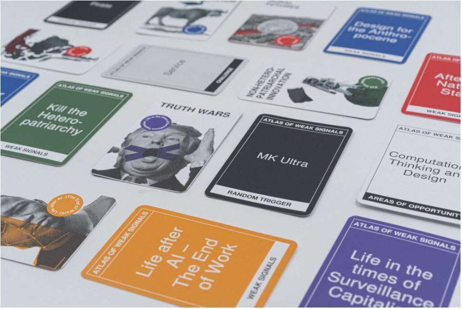
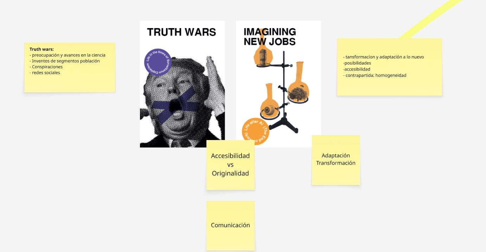
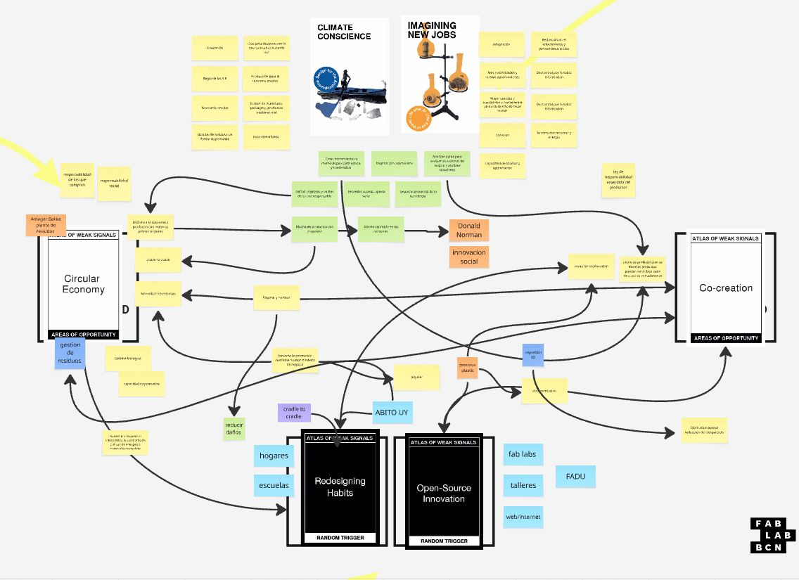
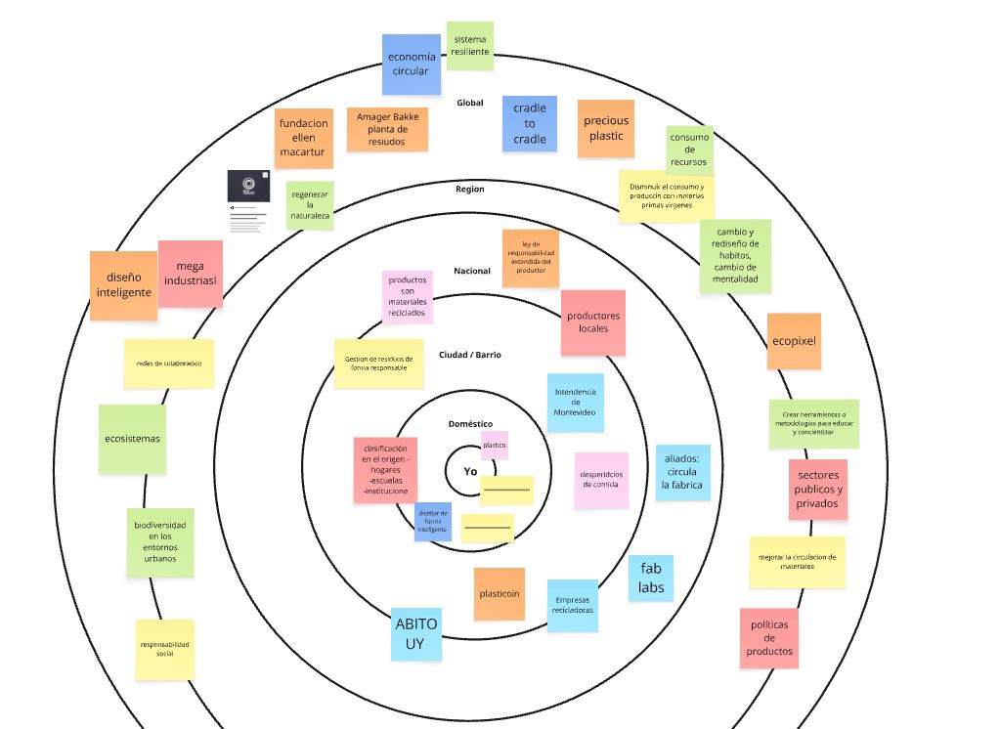
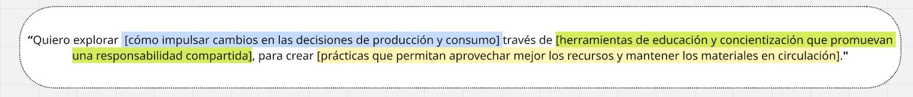

---
hide:
    - toc
---
#*MD01*. Mapear, conectar y descubrir

En este módulo, como primer acercamiento a un proceso de diseño, nos presentaron la herramienta de <strong>Atlas of Weak Signals</strong>. 

 <strong>Que son las <a href="https://drive.google.com/file/d/13d6TcjDLQpG3Ay64O-rq8u75mYHEc7zi/view?usp=sharing" target="_blank" rel="noopener noreferrer">Weak Signals?</a></strong>

Estas señales funcionan como indicadores tempranos de posibles cambios; podrían entenderse como una tendencia antes de una tendencia. A través de ellas se busca identificar ciertos puntos de inflexión que pueden
modificar el rumbo que se venía siguiendo. Es una herramienta muy útil para abrir debates, plantear preguntas y generar nuevas reflexiones.
También conversamos sobre los espacios de diseño como una herramienta de navegación dentro de la práctica del diseño, analizando cuáles son sus funciones clave y de qué manera pueden orientarnos durante el proceso.

    

En la primera clase tuvimos un acercamiento grupal a la herramienta a partir de dos cartas de interés. El intercambio generó conversaciones y puntos de vista que me permitieron observar la temática desde otra perspectiva. Esta experiencia me ayudó a comprender el valor del trabajo colaborativo, donde cada persona aporta desde sus propios conocimientos. Además, explorar los trabajos de mis compañeros me permitió descubrir nuevas conexiones y entender mejor las posibilidades de la herramienta.

<small><em>Resultado obtenido en la primera actividad grupal </em></small>

**Proceso Individual**

<small><em>Mapeo general de mi tablero</em></small>

Esta primera etapa fue experimental y abierta. Fui conectando temas cercanos a mi realidad, como la economía circular, la gestión de residuos y el diseño, con otros vinculados a la tecnología, la educación, la colaboración y la sostenibilidad. El principal desafío fue comprender que la herramienta no busca llegar inmediatamente a una conclusión, sino funcionar como un punto de partida para generar preguntas y abrir nuevas líneas de reflexión. 

**Espacio de Diseño Multiescalar**

Según el material presentado en clase "Un espacio de diseño es una colección física o digital de experimentos, objetos de referencia, proyectos, productos o materiales que apoyan el desarrollo de la intervención como ejercicio de investigación-acción".

A partir del mapeo comprendí que la economía circular atraviesa diferentes escalas y que cada actor tiene distintas posibilidades de intervención. Muchas veces la responsabilidad se concentra en las decisiones individuales, como separar los residuos o elegir productos más sostenibles, aunque gran parte del impacto se define previamente, durante el diseño y la producción. La educación y la concientización pueden orientar nuestros hábitos, pero necesitan estar acompañadas por políticas, infraestructura y nuevos modelos productivos que permitan sostener esos cambios. Por eso, me interesa explorar herramientas que ayuden a comprender el impacto de nuestras decisiones y, al mismo tiempo, permitan cuestionar y transformar las prácticas de quienes diseñan, producen y ponen los productos en circulación.

La circularidad aparece entonces como una construcción colectiva, aunque no todos los
actores tengan el mismo nivel de responsabilidad ni la misma capacidad de decisión. Una
transformación profunda requiere articular cambios culturales con decisiones de diseño,
regulaciones, incentivos e infraestructura, para que reparar, reutilizar y mantener los
materiales en circulación sea una posibilidad real y accesible, y no dependa solamente de la
voluntad individual.

<small><em> Analizamos el espacio de diseño definiendo tres puntos clave: 1)Problema / interés actual ¿qué quiero abordar hoy? 2) Inspiración de señales y metáforas ¿qué me hizo repensar? 3) Propuesta de acción / futuro deseado ¿qué quiero prototipar, imaginar, diseñar?</em></small>

Esta etapa me permitió transformar un conjunto amplio de intereses en una dirección de trabajo más clara. Comprendí que la educación puede funcionar como un punto de partida para visibilizar las responsabilidades de los distintos actores y cuestionar decisiones que solemos tomar de forma automática. Más que encontrar una respuesta definitiva, el mapeo me ayudó a formular mejores preguntas y a reconocer posibles caminos desde los cuales aportar a una transformación más consciente y colectiva.

