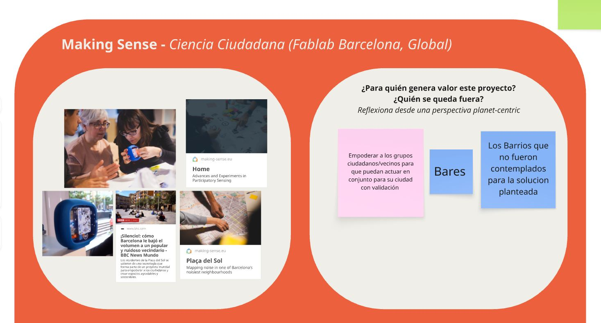
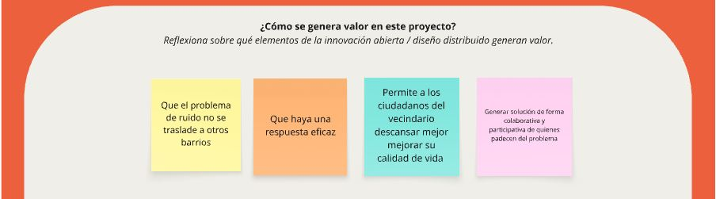
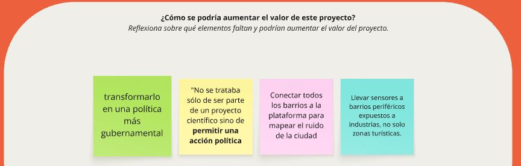
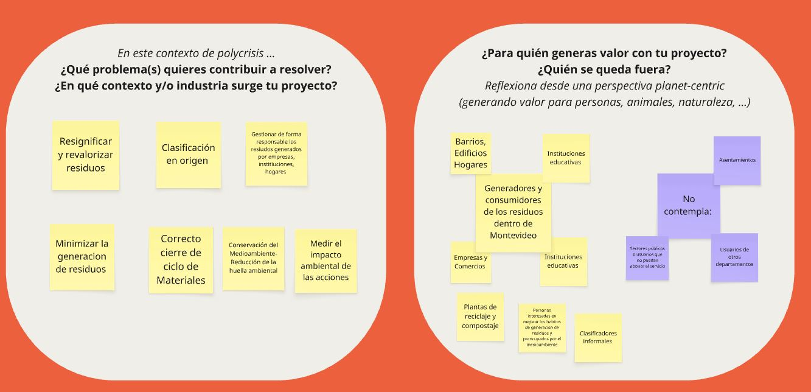
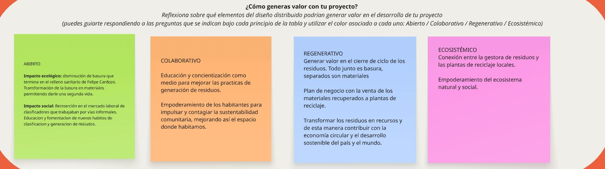

---
hide:
    - toc
---
#*MD01*. Innovación abierta y Distribuida
**Diseño Distribuido una fórmula de creación que fomenta futuros abiertos, colaborativos, y regenerativos.**

 El primer acercamiento al <strong> Distributed Design </strong>lo realizamos de manera grupal, analizando proyectos reales ya desarrollados. Esta primera aproximación práctica sirvió para familiarizarnos con la herramienta y comprender cómo observar un proyecto más allá de su resultado, identificando el problema que aborda, el contexto en el que surge y las personas para quienes genera valor. A partir de las preguntas orientadoras, también analizamos sus posibilidades de mejora desde las dimensiones abierta, colaborativa, regenerativa y ecosistémica del diseño distribuido. 

    

    

    

<small><em>Resultado obtenido en la primera actividad grupal </em></small>

**Individual**

Al comenzar el trabajo individual surgió una dificultad: todavía no tengo un proyecto definido ni una dirección clara hacia la cual avanzar, por lo que aplicar la herramienta a una idea aún abierta resultaba complejo. Para continuar explorando su funcionamiento y comprender mejor la mirada que propone, decidí tomar como caso de análisis a Ábito, mi actual lugar de trabajo, una empresa dedicada a la gestión sustentable de residuos con enfoque de triple impacto. Elegir un contexto cercano y conocido facilitó la conexión del ejercicio con situaciones concretas y el análisis de sus posibilidades reales de aplicación.

    
    

    

<small><em>Canvas miro del proyecto individual </em></small>

Este proceso permitió analizar el proyecto desde los cuatro conceptos del diseño distribuido, reconociendo sus fortalezas, los aspectos que requieren mayor atención y las oportunidades de mejora. El ejercicio también mostró que su valor va más allá de recuperar residuos: busca transformar la forma en que los percibimos y asumimos nuestra responsabilidad sobre ellos. Al relacionar educación, clasificación en origen y aprovechamiento de materiales, comprendí que la circularidad requiere tanto de la participación de las personas como de una red capaz de sostener esas prácticas. Reflexionar sobre quiénes se benefician y quiénes quedan fuera también permitió cuestionar el alcance de la propuesta y reforzar la importancia de construir una responsabilidad compartida, considerando las distintas realidades y vinculando el cuidado ambiental con el desarrollo de las comunidades. 

ⓘ &nbsp; Reflexión

<em>

Aunque todavía no tengo definido el proyecto que quiero desarrollar, esta herramienta funciona como un punto de partida para orientar su construcción. Me interesa avanzar hacia un proyecto integral, colaborativo e interdisciplinario, basado en una problemática real y significativa para una comunidad. Mi objetivo es involucrar a las personas durante todo el proceso para que la solución no sea diseñada únicamente para ellas, sino junto con ellas. De esta manera, el proyecto podrá generar un cambio real en quienes lo utilizan y construir un sentido de pertenencia que favorezca su apropiación y continuidad en el tiempo.
</em>

    
