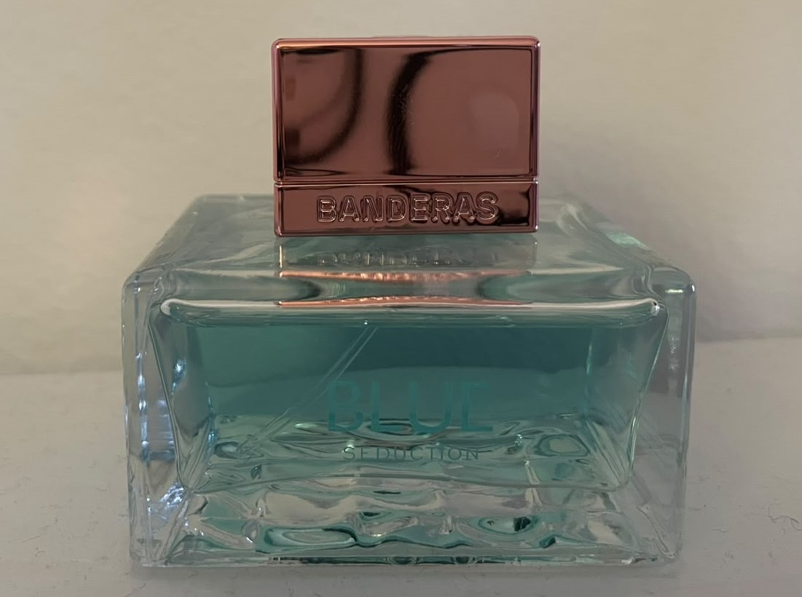
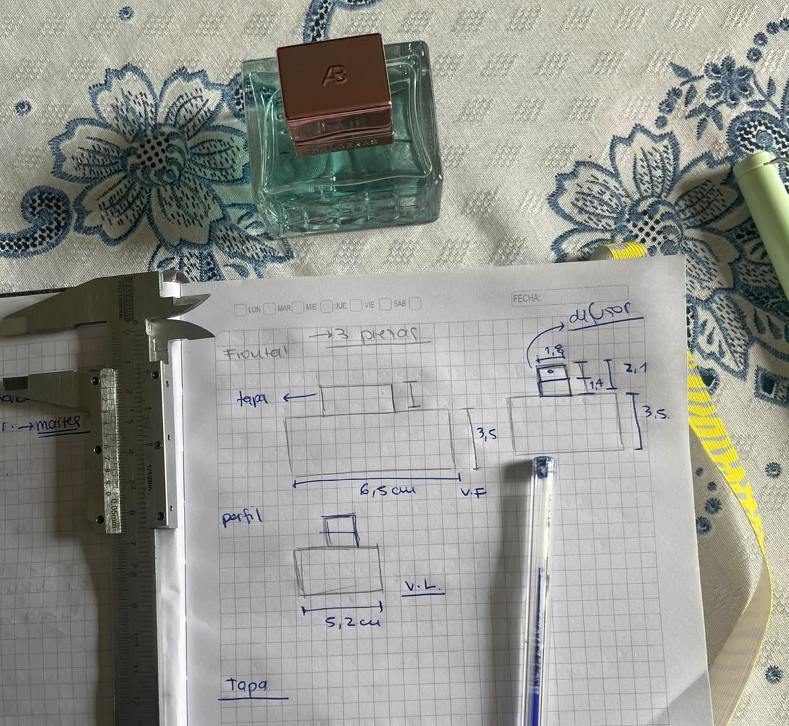
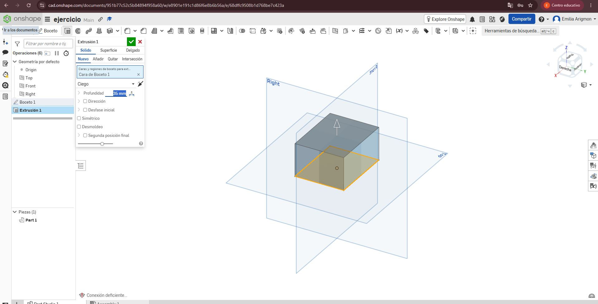
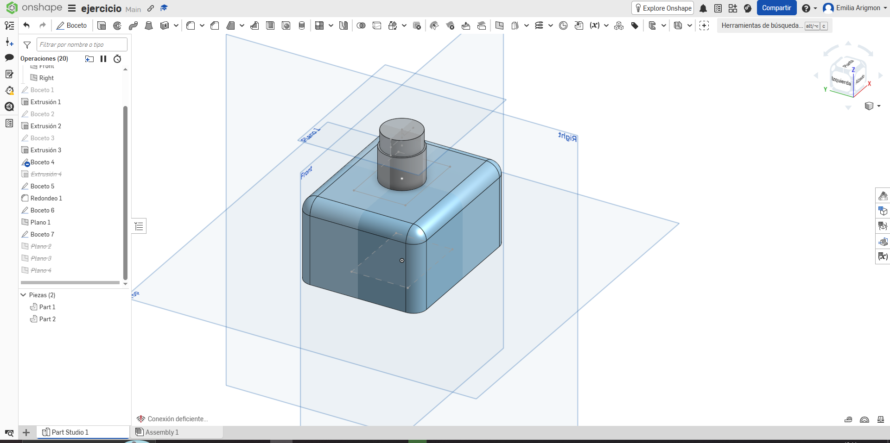
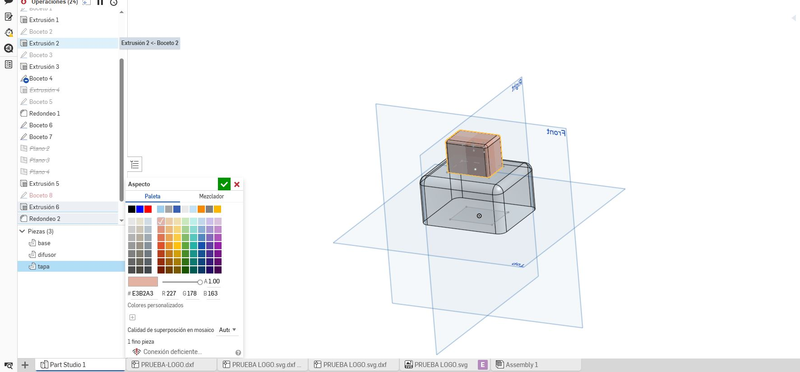
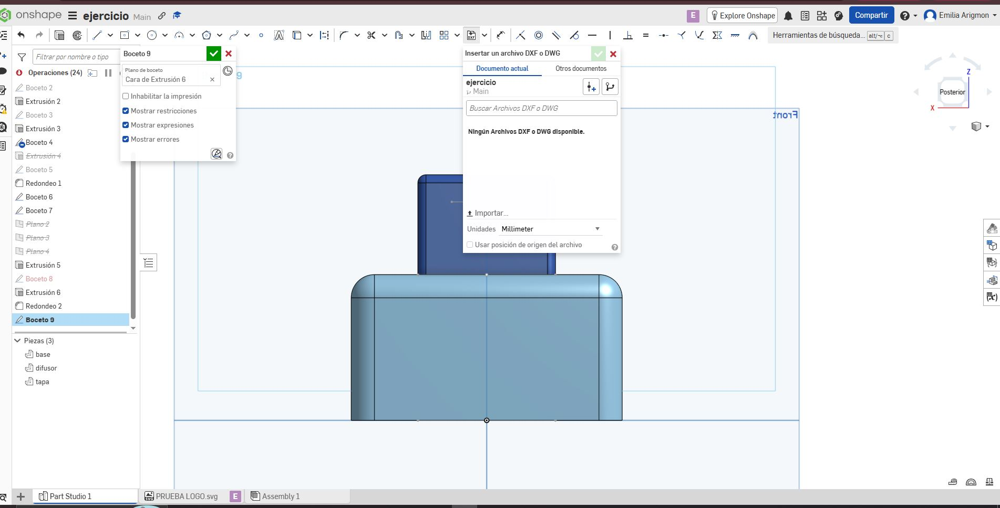
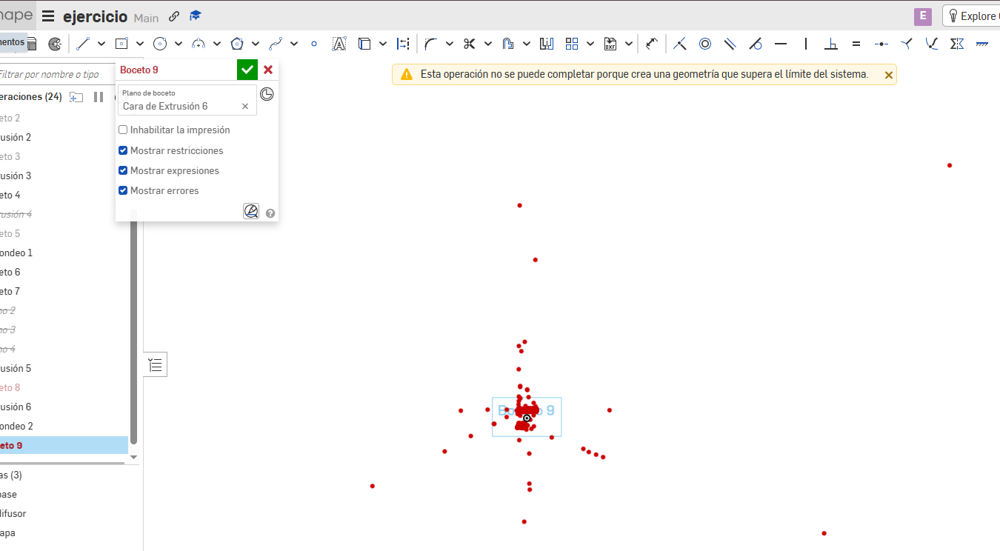
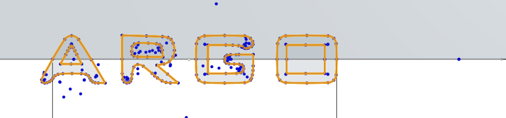
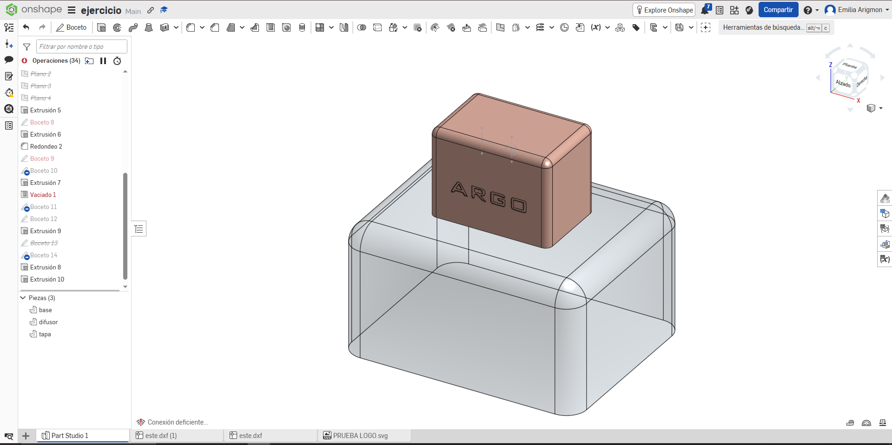
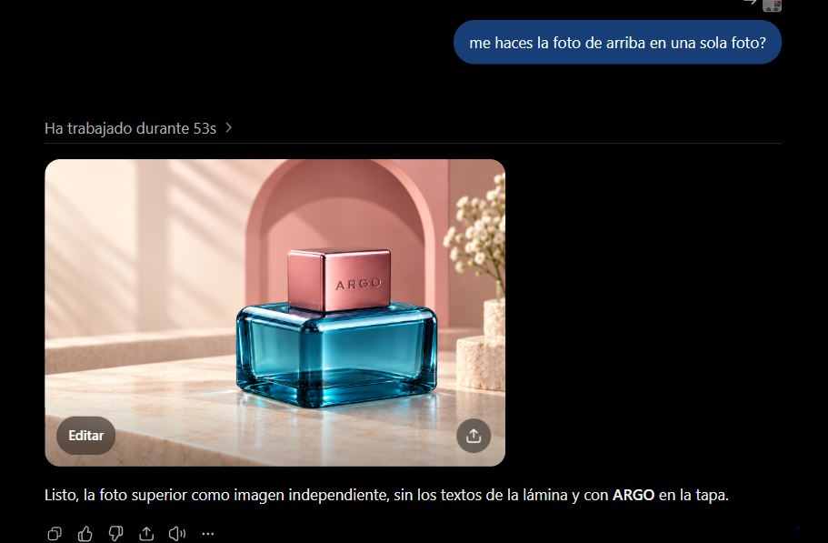

---
hide:
    - toc
---

# *MT02* - Diseño 2D y Modelado 3D

**Background**

Este módulo fue un pequeño respiro porque me encontré trabajando con herramientas que me resultaban más familiares. Como diseñadora industrial, ya había utilizado programas de diseño 2D y 3D, y actualmente trabajo principalmente con Illustrator y Fusion 360. Aunque no los uso todos los días y mi manejo es simple, me siento cómoda con ellos y considero que me defiendo bien. Esto hizo que pudiera acercarme al módulo con más confianza, comparar la nueva herramienta con las que ya conocía y seguir ampliando mis formas de diseñar.

**Ejercicio de modelado 3D y 2D**

Para esta etapa decidí probar un programa de modelado 3D que nunca había utilizado. Me pareció una buena oportunidad para conocer otra interfaz, explorar una lógica de trabajo diferente y, en el proceso, darme cuenta de cuánto valoro Fusion 360.

Elegí Onshape, un programa que funciona completamente en la nube y directamente desde el navegador, sin necesidad de instalarlo. Su interfaz es bastante intuitiva y tiene varios aspectos similares a Fusion, aunque algunas acciones se realizan de otra manera, y entender esas diferencias fue lo que más me costó.De igual manera vi varios tutoriales que me explicaban mejor su funcionamiento e interfaz.

Para comenzar a modelar elegí un frasco de perfume que tenía sobre mi escritorio. Primero observé y analicé su forma, identifiqué las distintas piezas que lo componen, tomé sus medidas y realicé un boceto como guía. El objeto está formado por tres partes principales: una base cuadrada de vidrio que contiene el perfume, un difusor metálico y una tapa de plástico con terminación metalizada.

    

    

Luego comencé con el modelado. Primero realicé la base de vidrio y, a partir de ella, fui creando nuevos bocetos y extrusiones para construir el difusor y, por último, la tapa. Lo más complejo fue entender cómo funcionaban algunas extrusiones realizadas desde diferentes planos proyectados sobre el objeto.

También me llamó la atención la forma en que Onshape registra cada acción y cómo se navega dentro del programa, porque estoy muy acostumbrada a la lógica de Fusion 360. Después de varios intentos y de probar distintas maneras de resolver algunas operaciones, logré completar correctamente las tres partes del frasco.

    

    

    

    

Por último, como indicaba el ejercicio, realicé un diseño 2D en un programa vectorial para incorporarlo al modelo 3D. Para esto utilicé Illustrator: elegí una tipografía, inventé una marca y convertí el texto en contornos para transformarlo en un archivo vectorial.

Luego exporté el diseño en formato DXF para insertarlo en Onshape. En el primer intento quedó demasiado grande y algunos contornos no estaban bien cerrados, por lo que el boceto se llenó de puntos rojos y no pude utilizarlo. Volví a exportarlo con un tamaño menor y, esta vez, logré colocarlo correctamente en la posición que quería sobre la tapa. Finalmente, realicé una extrusión hacia el interior para generar un bajo relieve similar a un grabado.

    

    

    

    

<small><em>Producto final modelado </em></small>

Por último, quise renderizar el modelo directamente en Onshape, pero para acceder a esa función necesitaba una suscripción paga. Como alternativa, exporté el archivo y lo abrí en Fusion 360, donde asigné los materiales correspondientes a cada pieza: vidrio para el frasco, metal para el difusor y plástico con terminación metalizada para la tapa. Después tomé capturas del modelo y utilicé ChatGPT para generar imágenes con un aspecto más realista.

    

Para finalizar, armé en Illustrator una <a href="https://drive.google.com/file/d/1mh2DWeNuUuO7mJ55biE_V9JLxHpTfPOR/view?usp=sharing" target="_blank" rel="noopener noreferrer">lámina</a> de presentación del producto. Incorporé los renders junto con vistas técnicas y cortes realizados en Fusion 360, con el objetivo de mostrar la composición del frasco y explicar con mayor claridad los encuentros y encastres entre sus distintas piezas.

    

ⓘ &nbsp; Reflexión

<em>

Este ejercicio me pareció bastante desafiante, pero a la vez muy interesante, porque me obligó a salir un poco de mi zona de confort y probar un programa nuevo. Antes de empezar investigué dos o tres opciones de modelado, pero por los tiempos de la entrega decidí trabajar con Onshape, ya que su interfaz era la más parecida a Fusion 360 y pensé que me resultaría más fácil adaptarme.

También creo que estuvo bien elegir un objeto sencillo, porque pude concentrarme en entender el programa sin complicarme todavía más con una forma difícil de modelar. 

Me gustó probar otra manera de trabajar y ver que se puede llegar al mismo resultado siguiendo caminos diferentes. De todas formas, después de esta experiencia sigo eligiendo Fusion, y me queda pendiente animarme a probar Rhino.
</em>

**Links de interes**  

https://www.youtube.com/watch?v=q1tiLwEI6uY&list=PLoPH28cIrLDbhIonaCsPcU2-dUCvCgHaS
https://www.youtube.com/watch?v=YewPgxPwu9Q&list=PLoPH28cIrLDbhIonaCsPcU2-dUCvCgHaS&index=3
https://www.youtube.com/watch?v=WFP90gU-s3I&list=PLiAAG68rQ-Jn2Pl3HqRh_8qc87mop3SbX&index=3