# MT03 - Corte Laser
**Luminaria en Corte Láser**

    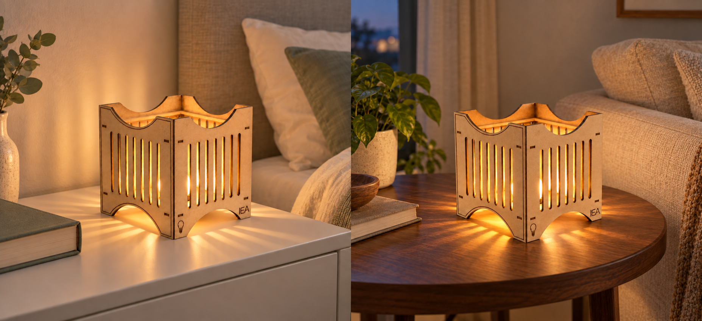

Premisa del ejercicio: "Diseñar la carcasa de una luminaria (sin sus componentes eléctricos) pensada para ser fabricada utilizando únicamente piezas laminares y encastradas cortadas en láser, sin otros materiales ni elementos de unión.” 

**Proceso**

<ul>
  <li>Máquina láser CO₂</li>
  <li>Material utilizado: MDF de 3 mm</li>
  <li>Laboratorio: Fab Lab Minas</li>
  <li>Fecha: 30/10/2026</li>
</ul>

Decidí hacer una luminaria sencilla en cuanto a su diseño, pero poniendo especial atención tanto en la forma como en la resolución de los encastres. Elegí enfocarme en este aspecto porque las tolerancias y los encastres siempre fueron temas que me costaron un poco más y quería aprovechar el ejercicio para entenderlos y resolverlos mejor.

Como la idea era utilizarla en mi mesa de luz, pensé una luminaria compacta y autoportante, donde la base y el resto de las piezas formaran parte del mismo conjunto.

<strong>Fusion</strong>

Comencé el modelado 3D en Fusion 360 parametrizando el espesor del material y la holgura de los encastres. Esto fue importante porque, si al momento de fabricar en el Fab Lab el material tenía otro espesor, podía modificar el parámetro y actualizar el modelo sin tener que rediseñar todas las piezas.

    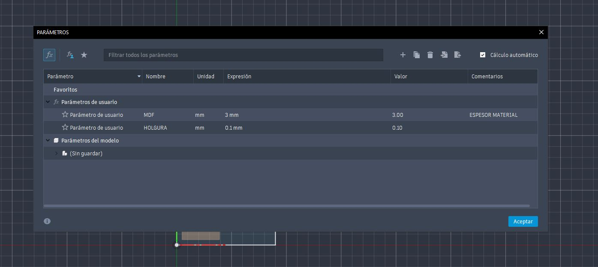

Para comenzar el diseño tomé como referencia el espacio de 45 × 45 × 45 mm destinado a la luz. A partir de ahí modelé la primera cara y luego repliqué su geometría utilizando el plano medio y la herramienta Mirror, lo que me ayudó a mantener la simetría y la correspondencia entre los encastres.

El parámetro del espesor fue clave durante todo el proceso, ya que las medidas de las ranuras dependían directamente del material. Por eso, la luminaria fue diseñada desde el inicio teniendo en cuenta cómo se unirían sus piezas, buscando reducir el margen de error al momento de cortarlas y ensamblarlas.

    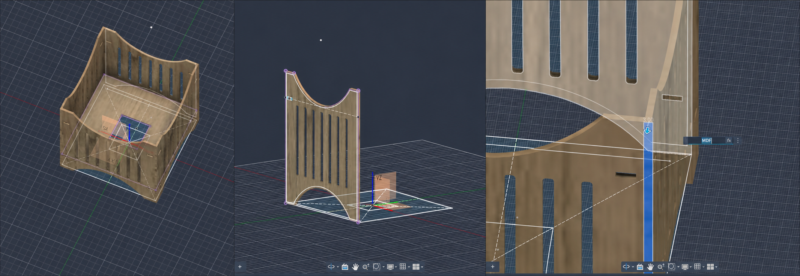

Una vez terminado el modelado 3D, pasé al diseño de los elementos para realizar el grabado ráster y el grabado vectorial. Para el ráster creé en Illustrator un logo con mis iniciales, lo convertí en contornos, lo exporté como SVG y lo incorporé al modelado. Para el grabado vectorial utilicé la imagen de una lamparita, que también vectoricé y exporté. Ambos diseños fueron extruidos hacia el interior para generar un bajo relieve.

 
Luego convertí todos los cuerpos en componentes y generé la placa de corte con la herramienta Arrange. Esto me permitió practicar el nesting, organizando las piezas para aprovechar mejor el material.
 

<a href="https://drive.google.com/file/d/15Q9jda9su1o9Lw_nIr2kXT_CXUJbjQDj/view?usp=sharing" target="_blank" rel="noopener noreferrer">Lámina de presentación del producto</a>  

<strong>Capas</strong>
 

Para llevar las piezas a RDWorks, proyecté sobre la placa todas las caras que se debían cortar y exporté cada boceto en formato DXF. Finalmente, abrí el archivo en Illustrator y organicé las líneas por capas y colores según la acción que debía realizar la máquina: rojo para corte, azul para grabado vectorial y verde para ráster.

    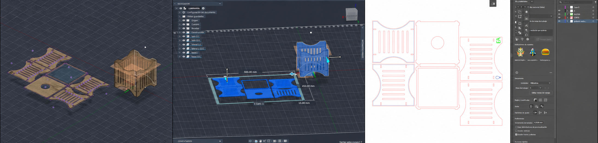

<strong>RDWORKS</strong>

Luego importé en RDWorks el archivo DXF que había preparado en Illustrator. Allí ajusté los parámetros correspondientes a cada operación y definí el orden en el que la máquina debía realizarlas: primero el ráster, después el grabado vectorial y, por último, el corte.

Al abrir el archivo noté que los diseños vectoriales no habían quedado del todo bien: en la imagen de la lamparita no aparecía la parte del vidrio y las letras tenían líneas superpuestas. Para solucionarlo, volví a colocar ambos diseños directamente en el archivo de Illustrator, en lugar de utilizar los que habían sido exportados desde Fusion. De esta forma funcionaron correctamente. Además, utilicé la opción de RDWorks para eliminar líneas superpuestas y asegurarme de que no se repitieran recorridos durante el corte o el grabado.

    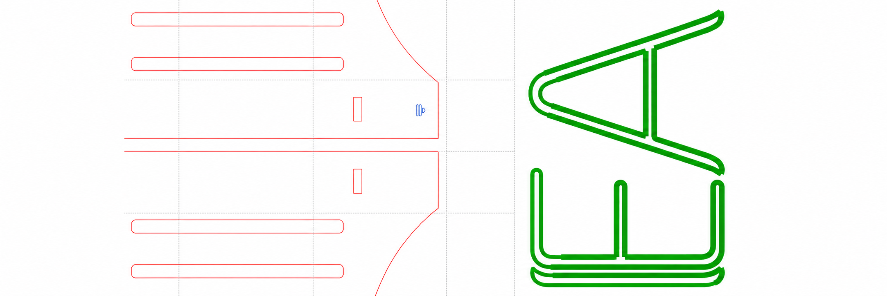

<strong>Práctica Fab Lab Minas</strong>

La parte práctica la hicimos directamente en el Fab Lab, ya que los parámetros varían según cada máquina y era necesario comprobar su funcionamiento antes de realizar el corte definitivo. Como nunca había utilizado RDWorks, además de lo trabajado en clase tuve que mirar varios videos tutoriales para comprender mejor el programa y reconocer qué aspectos debía tener en cuenta al preparar el archivo.

Durante la práctica, cada uno ajustó su archivo según lo aprendido en clase y las particularidades de la máquina que iba a utilizar. Primero nos explicaron los pasos necesarios para enviar y guardar el archivo en la cortadora láser. Luego colocamos la placa de MDF de 3 mm, comprobamos que la distancia entre el láser y el material fuera de 7 mm, definimos el punto de origen del trabajo y verificamos que el área de corte fuera correcta. Una vez realizados todos estos controles, pusimos la máquina en funcionamiento.

<strong>Parámetros establecidos</strong>

    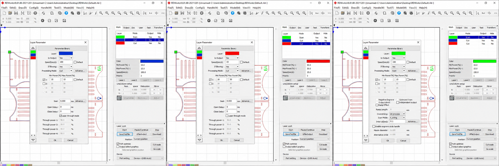

<strong>Simulación</strong>

    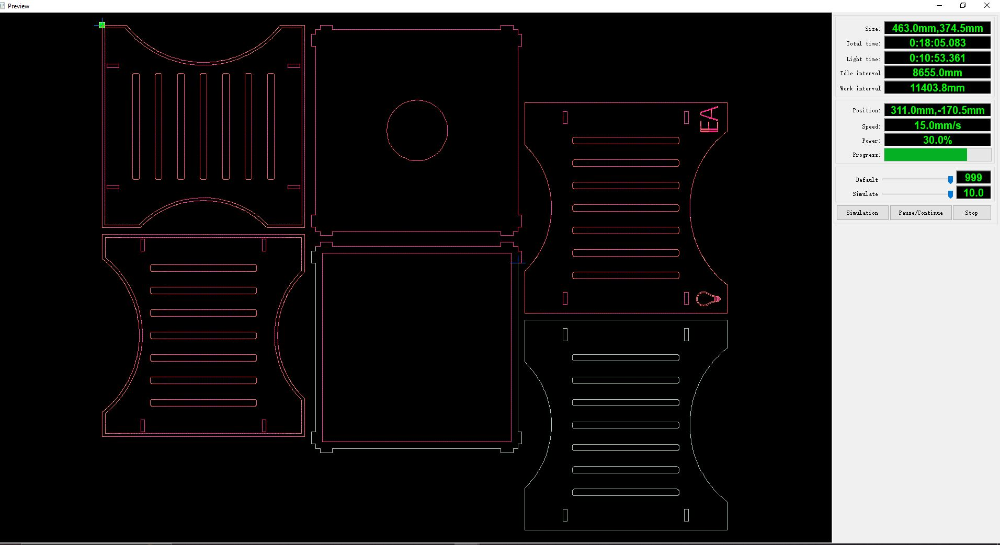

<strong>Proceso de corte y Resultado Final</strong>

    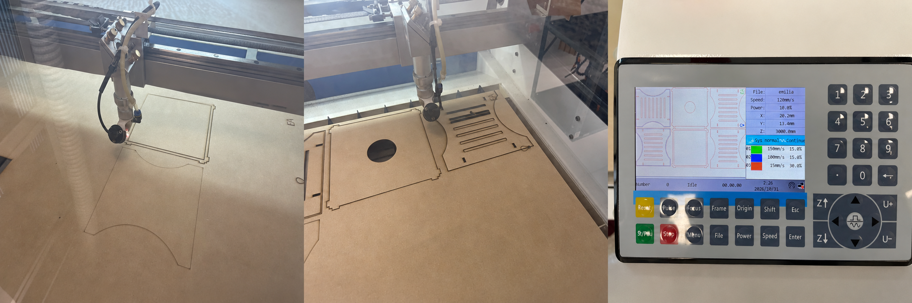

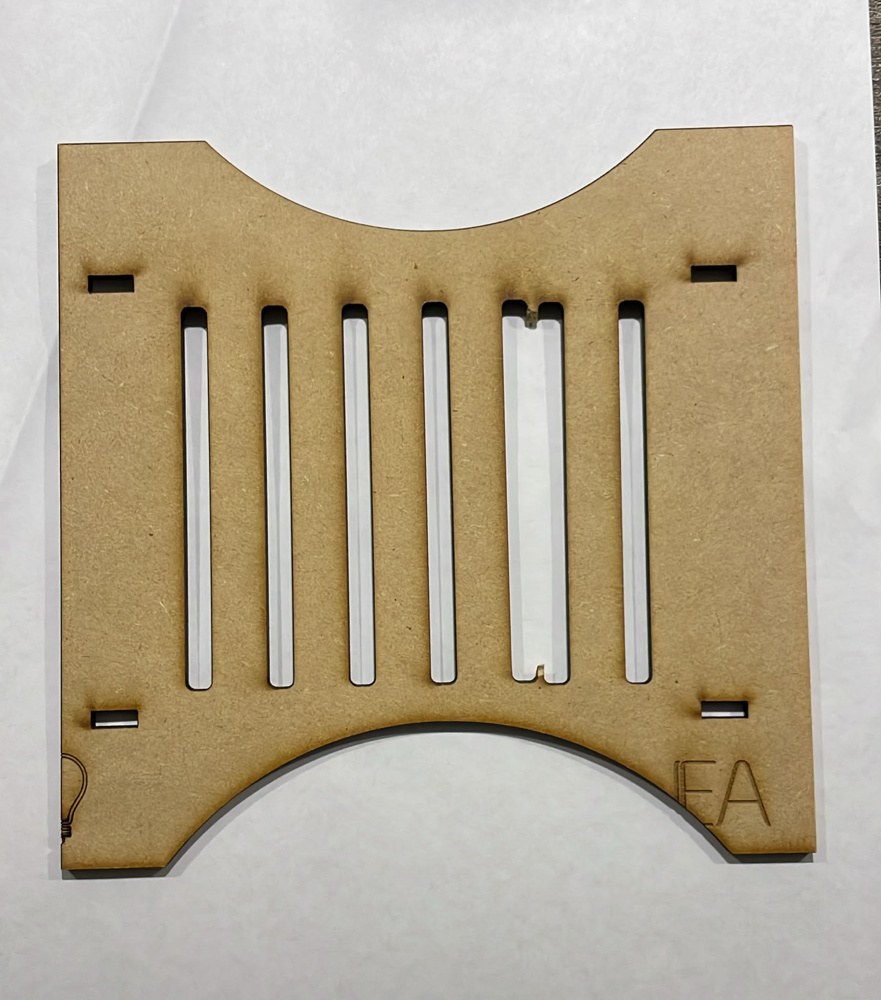 

  

<small><em>Error en el corte, hipotesis se movió la placa de mdf en la cama de corte </em></small>

<strong>Lámpara Terminada :)!</strong>

    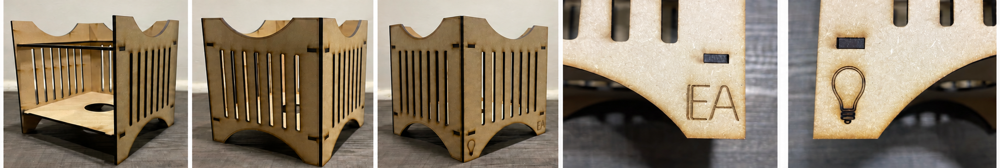

ⓘ &nbsp; Experiencia

<em>

La experiencia en el Fab Lab me resultó muy enriquecedora e interesante, principalmente por el intercambio de conocimientos entre compañeros y docentes. Poder conocer el proceso que realizó cada uno hasta llegar a su resultado final también aportó distintas formas de resolver un mismo ejercicio.

En cuanto a mi experiencia personal, me gustó mucho poder realizar esta etapa de manera presencial. Preparar los archivos, conocer la máquina, manejarla por nosotros mismos y entender su funcionamiento hizo que el aprendizaje fuera mucho más completo. Fue una experiencia que disfruté mucho y que me dejó muy entusiasmada por seguir aprendiendo y experimentando con este tipo de herramientas..
</em>

<strong>Foro grupal ;)</strong>

    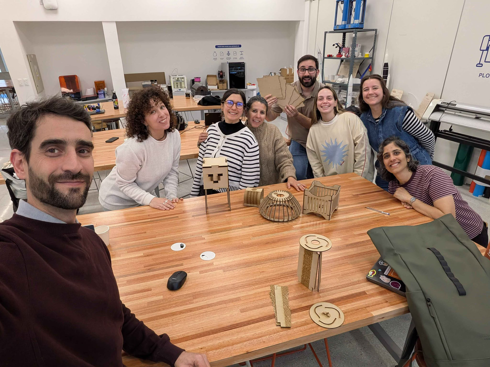

<strong>Links RDWorks</strong>

<ul>
  <li>
    <a href="https://www.youtube.com/watch?v=voLjKCa7s4g&list=PLyGjC9ELMtRqeNT2Ye19wsmUhJ-6zuxbY&index=7"
       target="_blank" rel="noopener noreferrer">
      Tutorial de RDWorks 1
    </a>
  </li>

  <li>
    <a href="https://www.youtube.com/watch?v=dGTe4RSY3-Y"
       target="_blank" rel="noopener noreferrer">
      Tutorial de RDWorks 2
    </a>
  </li>
</ul>

 

